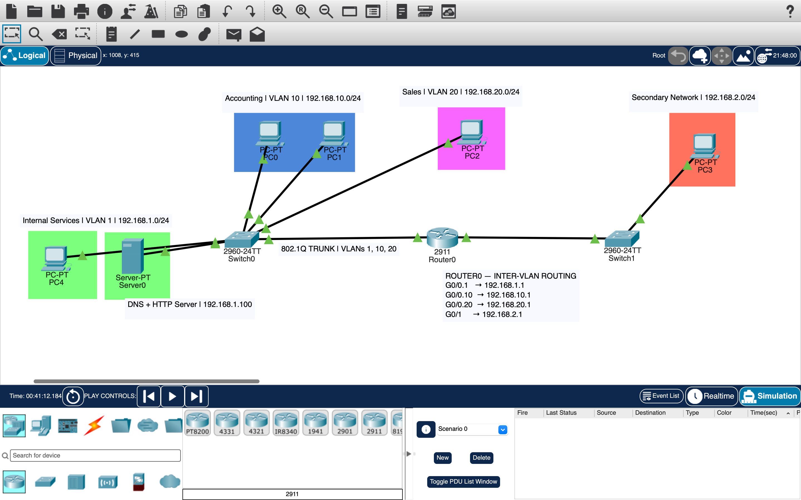
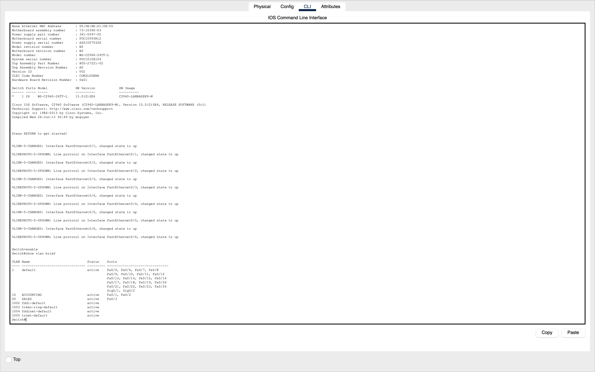
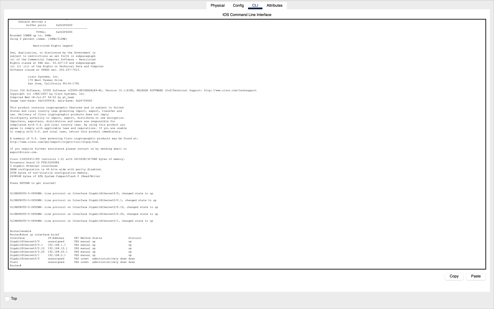
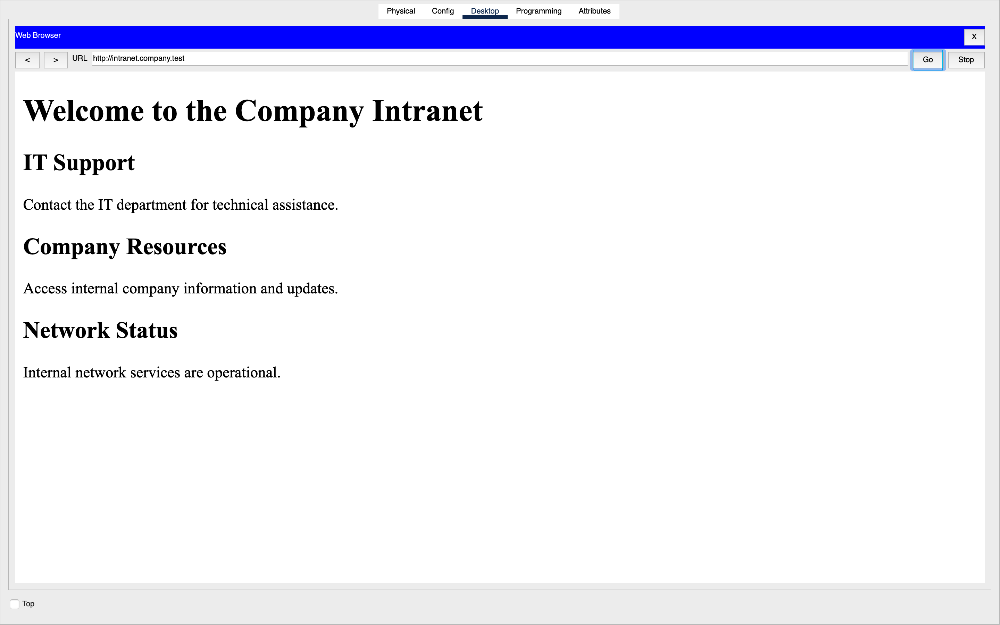
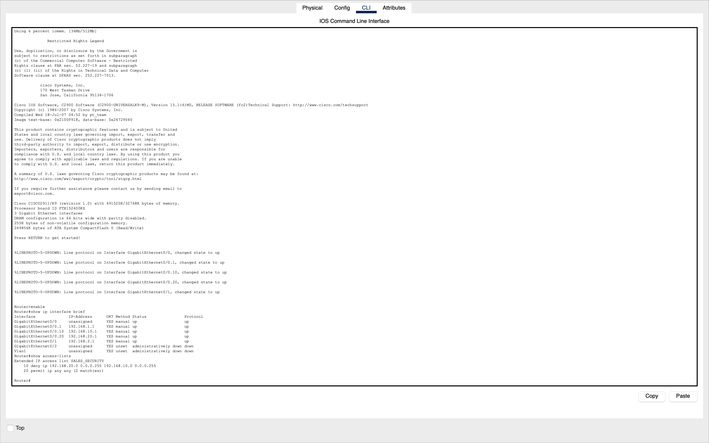

# Small Business Network Infrastructure & Security

## Project Overview

Designed and configured a simulated small-business network using Cisco Packet Tracer. The project demonstrates network connectivity, routing, automatic IP address assignment, internal services, network segmentation, access control, and troubleshooting.

## Technologies Used

- Cisco Packet Tracer and Cisco IOS
- Ethernet switching and IPv4 addressing
- Inter-subnet and inter-VLAN routing
- 802.1Q VLAN trunking
- DHCP and DNS
- HTTP web server
- Extended Access Control Lists (ACLs)
- ICMP and network troubleshooting commands

## Network Architecture

The network includes multiple PCs, two switches, one router, and an internal server.

### Network Segments

| Network | Subnet | Purpose |
|---|---|---|
| Accounting — VLAN 10 | 192.168.10.0/24 | Accounting department |
| Sales — VLAN 20 | 192.168.20.0/24 | Sales department |
| Internal services — VLAN 1 | 192.168.1.0/24 | DNS, HTTP, and existing clients |
| Secondary office network | 192.168.2.0/24 | Additional routed network |

## Key Features

### Routing and VLANs

Configured router subinterfaces and an 802.1Q trunk to enable communication between VLANs while maintaining separate broadcast domains.

### DHCP

Configured DHCP pools for multiple subnets, including excluded address ranges, default gateways, and DNS server settings.

### DNS and Web Services

Configured an internal DNS service and HTTP server, allowing clients to access the company intranet at `http://intranet.company.test`.

### Network Security

Implemented an extended ACL to restrict Sales-to-Accounting traffic while allowing access to internal services.

### Troubleshooting

Diagnosed and corrected simulated network issues involving incorrect default gateways, VLAN assignments, and DNS service availability.

## Verification

Tested network connectivity using ICMP ping, inspected router and switch configurations using Cisco IOS commands, verified DHCP address assignments, and confirmed internal website access.

## Project Files

The repository contains the final Cisco Packet Tracer topology and screenshots documenting network configuration and verification.

## Network Topology

## Configuration Screenshots

### VLAN Segmentation

### Router Interfaces and Inter-VLAN Routing

### Company Intranet

### Network Security — Access Control Lists

  
  
